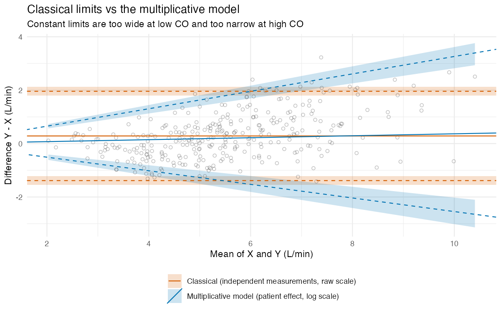

# Agreement between cardiac output measurement methods

Can a non-invasive device replace an invasive reference for measuring cardiac output (CO)?
The usual answer, a Bland–Altman analysis, treats every measurement as independent and assumes the error has the same size at every CO.
In clinical studies neither is true: each patient is measured several times, and the error often grows with CO.
This repository shows, in R and on simulated data, what goes wrong when that structure is ignored and how mixed-effects models fix it.

**Full write-up with interactive figures: [danielmoreno.de/projects/cardiac-output-agreement](https://danielmoreno.de/projects/cardiac-output-agreement)**



## Main results

- **Ignoring the patient breaks the uncertainty, not the estimates.** With 40 patients × 8 measurements and an ICC of 0.75, the classical 95% CI for the bias covers the true bias in only 58% of simulated datasets. The additive mixed model covers it in 95%.
- **Constant limits are wrong at both ends.** When the error grows with CO, the additive limits contain 100% of future differences at 3 L/min and only 83% at 8 L/min. The multiplicative model contains 95% at every CO.
- **The same limits of agreement can hide different devices.** Two devices with the same limits behave differently over repeated measurements of one patient, and only the joint distribution (an ellipse) tells them apart.

Every number comes from the Quarto documents in `analysis/`, where it is computed from the simulations.

## Models

For patient $i$ and measurement $j$, both models share the same random-intercept structure

$$
D_{ij} = \beta_0 + u_i + \varepsilon_{ij},\quad u_i \sim N(0,\sigma_u^2),\quad \varepsilon_{ij} \sim N(0,\sigma_\varepsilon^2),
$$

and differ only in how the disagreement $D_{ij}$ is defined.

**Additive model:** $D_{ij} = Y_{ij} - X_{ij}$, with limits of agreement for the difference

$$
\text{LoA} = \beta_0 \pm 1.96\sqrt{\sigma_u^2 + \sigma_\varepsilon^2}.
$$

**Multiplicative model:** $D_{ij} = \log(Y_{ij}/X_{ij})$, with limits of agreement for the ratio $Y/X$

$$
\text{LoA}_{Y/X} = \exp\left(\beta_0 \pm 1.96\sqrt{\sigma_u^2 + \sigma_\varepsilon^2}\right).
$$

The bias gets a Wald confidence interval, and the limits of agreement get a patient (cluster) bootstrap with percentile intervals.

## Repository structure

```
analysis/
  agreement-analysis.qmd   the methods step by step on one simulated study
  monte-carlo.qmd          when and why the classical analysis fails, theory checked against simulation
  joint-agreement.qmd      the joint ellipse and how to decide whether a device is acceptable
  references.bib
R/
  simulate_study.R         simulates a study under the additive or multiplicative model
  fit_agreement.R          fits the random-intercept model by REML (lme4): bias, variance components, LoA
  bootstrap_loa.R          patient bootstrap for the limits of agreement
  fit_balanced.R           closed-form REML for balanced designs, used in the simulations
  joint_agreement.R        joint agreement of the repeated differences of one patient
  run_simulation.R         runs the Monte Carlo studies and saves results/
results/
  study1.rds, study2.rds   one row per simulated dataset, read by monte-carlo.qmd
figures/                   figures used in this README and the documents
AGENTS.md                  the rules and decisions I give AI coding agents working on this project
```

## How to run it

Tested with R 4.5.2 and Quarto 1.10. R packages: tidyverse (2.0.0), lme4 (1.1.37), gt (1.3.0), scales (1.4.0) and knitr (1.50).

```r
install.packages(c("tidyverse", "lme4", "gt", "scales", "knitr"))
```

The simulation results are already in `results/`, so the documents render without running the simulations again:

```bash
quarto render analysis/agreement-analysis.qmd
quarto render analysis/monte-carlo.qmd
quarto render analysis/joint-agreement.qmd
```

To run the Monte Carlo studies again, from the project folder:

```bash
Rscript R/run_simulation.R pilot   # 20 datasets per scenario: prints the run time and an estimate for the full run
Rscript R/run_simulation.R         # 1,000 datasets per scenario: overwrites results/study1.rds and results/study2.rds
```

The simulations use the closed-form fit in `R/fit_balanced.R` instead of `lmer()`, which would be too slow for thousands of datasets with hundreds of bootstrap refits each. `monte-carlo.qmd` checks the two against each other.

## Context

This project is the analysis part of my master's thesis in Mathematics (TUM, 2026).
The thesis used real data from a clinical study at Philips. Here the methods are rewritten as reproducible R code on **simulated data only**, so the true values are known and every method can be checked against them.

## License

[MIT](LICENSE)
